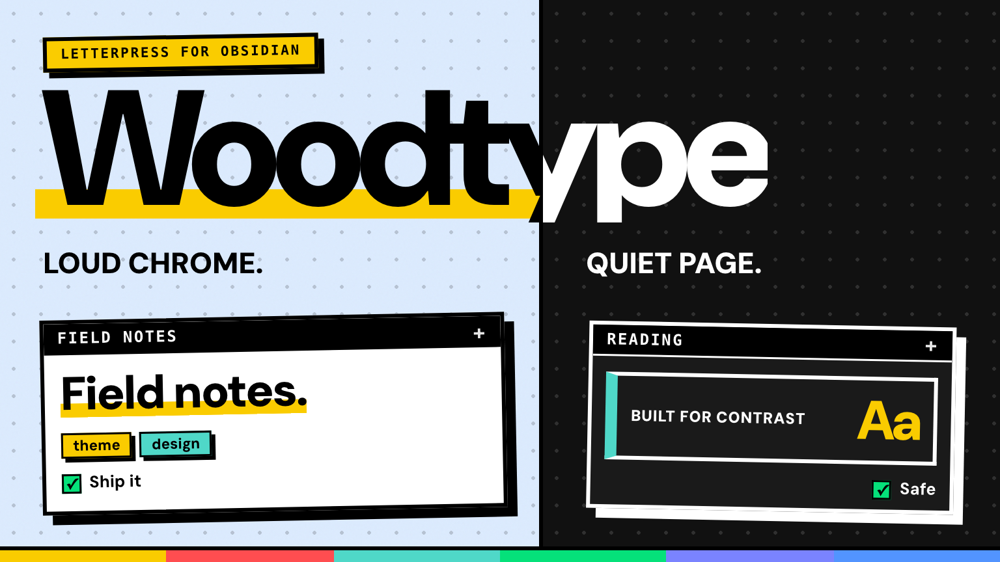

# Woodtype

**A letterpress neubrutalist theme for Obsidian.** Loud chrome, quiet page:
heavy ink borders, hard offset shadows and chunky display type, built so text
never disappears into its background.

## Features

- **Hard-edged surfaces** — 2.5px ink borders, zero radius and offset shadows.
- **Contrast-safe colour system** — tags, table hovers, links, inline code,
  selections, checkboxes and list markers all flip to the correct ink for
  their surface, in light and dark mode.
- **Neubrutalist lists** — square bullets with a yellow hard offset, and
  numbered badges in reading view, live preview and canvas cards.
- **Quiet reading page** — tight measure, strong hierarchy and a single
  accent hue instead of a rainbow.
- **Canvas aware** — paper cards, themed edges, group chips and legible
  markers/links on every card colour.
- **RTL aware** — callouts, quotes, headings and embeds use logical borders,
  so Arabic notes mirror cleanly.
- **Self-contained** — DM Sans is embedded; no remote fonts, snippets or
  companion themes required.

## Install

### Community themes

**Settings → Appearance → Themes → Browse → Woodtype**, or
[add it directly](https://community.obsidian.md/themes/woodtype).

### Manual

1. Download this folder.
2. Put it in `<your vault>/.obsidian/themes/Woodtype/`.
3. Open **Settings → Appearance → Themes** and choose **Woodtype**.

## Settings

Woodtype works without plugins. With [Style Settings](https://github.com/mgmeyers/obsidian-style-settings)
you also get:

| Setting | Default | What it does |
| --- | --- | --- |
| Accent | `#5294FF` | Focus rings, selection and accent UI |
| Shadow weight | `4px` | Distance of the hard offset shadows |
| Corner radius | `0px` | Keep it sharp, or soften it |
| Reading width | `700px` | Maximum line length |
| Focus mode | off | Dims sidebars until hovered |
| High contrast | off | Pushes muted text and hairlines to full ink |

## Compatibility

- Obsidian **1.10+**
- Desktop and mobile
- Light and dark mode; system mode follows Obsidian

## Credits

- Typeface: **DM Sans**, Copyright 2014 The DM Sans Project Authors,
  licensed under the SIL Open Font License 1.1 (see `OFL.txt`). The font is
  embedded in `theme.css` so the theme renders offline.
- Theme and code: **Abdallah Aladl**.

## License

MIT — see `LICENSE`.
